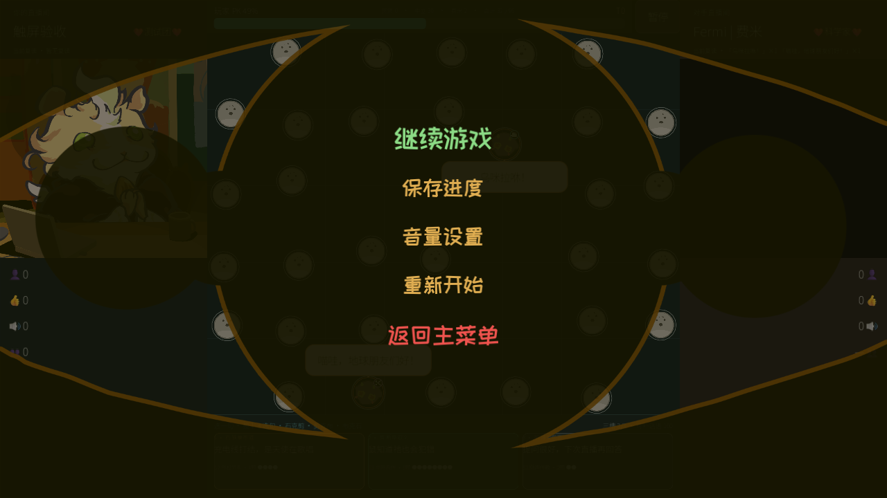
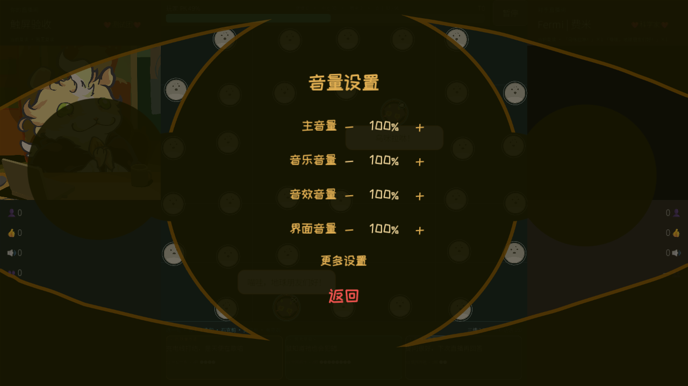
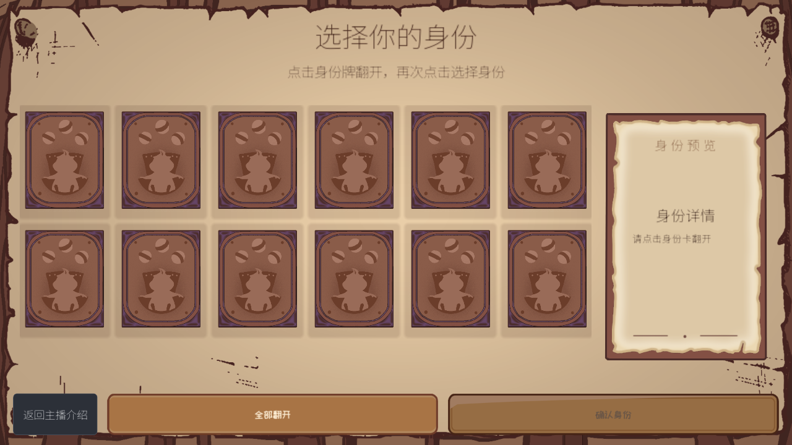
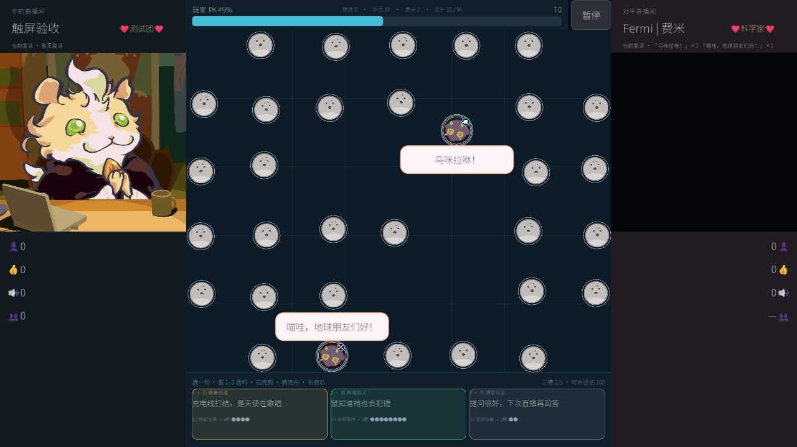

# INT-20 最新main集成运行证据

代码提交：`ab4bf94f`；目标main：`210f274e`；已验收优化：`129a603`。Godot 4.7.2 Steam，Windows D3D12 Forward+，RTX 3050 Laptop。下列均为集成工作树真实GUI截图，1280×720，无截图替代动画。

| 画面 | 证明内容 |
| --- | --- |
|  | 保留main美术，PK触摸后弹出同一PauseMenu |
|  | 保留main音量操作，补回更多设置访问全屏/光效 |
|  | main新身份美术与初始全卡背面、无默认黄框共存 |
|  | PK触屏入口保留，棋盘原范围不变 |

运行日志：pk/rest/global/identity/loading/boundary/infection/audio/ending/ending-restart/story-locked/story-unlocked 共12项均完成，无FAIL或运行脚本错误；PK首次Start-Process -Wait的ExitCode空值不作为退出码证据，以其DONE failures=0及真实输入检查为准，其余11项进程ExitCode=0。ending.log包含音频100864帧、最长静音0ms、完整片尾/标题解锁；ending-restart.log与两个story日志验证持久化和隐藏入口。

感染15秒回归结果见infection.json（892帧，96棋子，30转换，p50 16.632ms、p95 20.261ms）。未做10系显卡和Android真机验证，不以该数据宣称所有设备流畅。冷导入的缓存建立/编辑器配置诊断见任务日志，运行日志独立保存。
