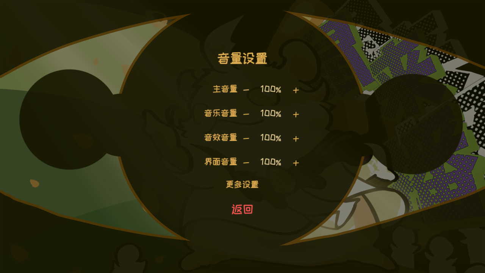

# UI-SET-01 真实运行预览

代码提交：36c9f1695f4886c19df30a4b3cc87a22cfb683ad；1280×720，Godot 4.7.2 Steam D3D12。复用main已有pause_background.png与ZCOOL字体，无新增外部美术资源。

uiset01.log：14条实际GUI检查通过；uiset01-pk.log、uiset01-rest.log、uiset01-titlemusic.log：触屏暂停/全屏退出/音乐回归通过，四个进程退出0。固定低档480×270由运行态SubViewport实测，旧标准配置加载与恢复默认同样为低档。长性能对比benchmark没有重跑，不扩大本轮验证结论。
