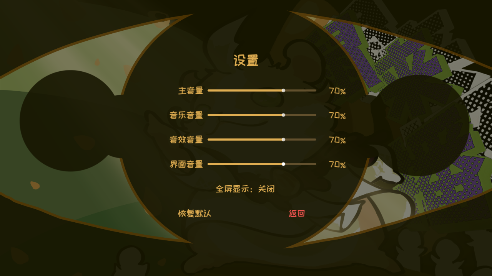

# UI-SET-02 真实运行证据

代码提交：c8722e853c7f56f171c8bd443033f9d2b54fe2ae；Godot4.7.2 Steam D3D12，1280×720。复用项目现有暂停底图/快乐字体，原生HSlider和CheckButton；没有旧灰色面板、“更多设置”或滑块提示。

四条滑块真实鼠标拖动、数值与保存、全屏显示、重置、标题音乐、Esc分层均通过（uiset02.log 18项）。PK触屏、结算/历史页与标题音乐回归日志同时附带，四个进程退出0。Android/10系显卡未实机验证，本轮未重跑性能长基准。
